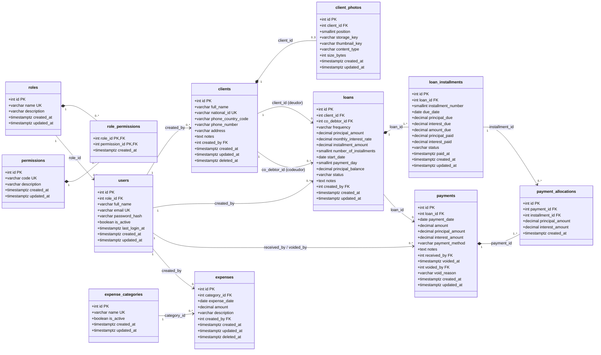

# Diseño de base de datos

Motor: **PostgreSQL** · Migraciones: **Knex** (`src/migrations`) · 12 tablas + función `set_updated_at()`.

> Para ver el diagrama en VS Code instala la extensión **Markdown Preview Mermaid Support** y abre la vista previa (`Ctrl+Shift+V`). GitHub y GitLab lo muestran directamente.

## 1. Diagrama UML (diagrama de clases del modelo de datos)

Leyenda de relaciones:
- `*--` **composición**: el hijo no existe sin el padre (si se borra el padre, se borran los hijos).
- `-->` **asociación**: referencia por llave foránea; el padre no se puede borrar mientras tenga hijos.
- Multiplicidad: `1`, `0..*` (cero o muchos), `0..3` (máximo tres), etc.

## 2. Las tablas por módulo

| Módulo de la cotización | Tablas |
|---|---|
| Usuarios y roles | `roles`, `permissions`, `role_permissions`, `users` |
| Clientes | `clients`, `client_photos` |
| Créditos | `loans`, `loan_installments` |
| Cobros | `payments`, `payment_allocations` (+ `loan_installments`) |
| Gastos | `expense_categories`, `expenses` |
| Reportes | No tienen tablas propias: se calculan con consultas sobre las anteriores (ver sección 4) |

## 3. Reglas de negocio que la base de datos garantiza

Estas reglas se validan **también** en el backend (para devolver mensajes claros), pero la BD es la última línea de defensa: aunque haya un bug en el código, no puede quedar un dato inválido.

| Regla | Dónde |
|---|---|
| Máximo 3 fotos por cliente | `client_photos`: `position BETWEEN 1 AND 3` + único (`client_id`, `position`) |
| Cédula única entre clientes no eliminados | Índice único parcial `clients_national_id_unique ... WHERE deleted_at IS NULL` |
| Indicativo con formato `+57` | `clients_phone_country_code_check` |
| El codeudor es otro cliente registrado | FK `co_debtor_id → clients` + `co_debtor_id <> client_id` |
| Crédito mensual exige tasa; quincenal exige cuota y número de cuotas | `loans_terms_check` |
| Las cuotas quincenales cubren al menos el capital | `installment_amount * number_of_installments >= principal_amount` |
| El saldo de capital nunca es negativo ni mayor al prestado | `loans_principal_balance_check` |
| Cuota = capital + interés | `loan_installments_amount_due_check` |
| Lo pagado de una cuota no supera lo debido | `loan_installments_paid_check` |
| Pago = capital + interés | `payments_split_check` |
| Un crédito con pagos no se puede borrar | FK `payments.loan_id` con `ON DELETE RESTRICT` |
| `updated_at` siempre al día | Trigger `set_updated_at()` en cada tabla |

## 4. Cómo sale cada reporte de la cotización

| Reporte | Fuente |
|---|---|
| Listado diario de cobros | `loan_installments` con `due_date <= hoy` y `status IN ('pending','partially_paid')` |
| Ganancia diaria (intereses recaudados) | `SUM(payments.interest_amount)` del día, sin anulados (`voided_at IS NULL`) |
| Colocación diaria | `SUM(loans.principal_amount)` por `start_date` |
| Recolección diaria de capital | `SUM(payments.principal_amount)` del día, sin anulados |
| Consolidado mensual | Los cuatro anteriores agrupados por mes |
| Efectividad de cobro mensual (%) | `SUM(cuotas pagadas del mes) / SUM(amount_due de cuotas que vencían en el mes) × 100` |

## 5. Decisiones de diseño (y por qué)

1. **Capital e interés separados en cuotas y pagos.** Los créditos quincenales tienen cuota pactada (ej. $1.000.000 en 10 cuotas de $120.000): se reparte en $100.000 de capital + $20.000 de interés por cuota. Así *ganancia diaria* y *recolección de capital* se calculan igual para ambas frecuencias, sin `if` en los reportes.
2. **`payment_allocations`.** Un pago puede cubrir una cuota atrasada y parte de la siguiente. Esta tabla registra a qué cuota fue cada peso, lo que hace posible el reporte de efectividad.
3. **Los pagos no se borran, se anulan** (`voided_at`, `voided_by`, `void_reason`). Si se borrara un pago de ayer, el reporte de ayer cambiaría. Con anulación queda la trazabilidad.
4. **Borrado lógico** (`deleted_at`) en clientes y gastos: un cliente con historial de créditos no puede desaparecer.
5. **`principal_balance` desnormalizado en `loans`.** Se podría calcular sumando pagos, pero la lista de cobros del día lo necesita para cada crédito; guardarlo evita consultas pesadas en el celular. Se actualiza en la **misma transacción** que registra el pago.
6. **Fotos: se guarda la llave del objeto, no la URL.** El bucket de R2 es privado y las URLs firmadas caducan; el backend genera una URL nueva cada vez que se piden.
7. **Estados como `varchar` + `CHECK`** en vez de tipos `ENUM` de Postgres: agregar un estado nuevo es una migración simple (cambiar el check) y no requiere `ALTER TYPE`.
8. **Dinero en `decimal(14,2)`**, nunca `float`. En Node se convierte a `Number` (seguro para pesos colombianos hasta billones). Las columnas `date` se leen como texto `'YYYY-MM-DD'` para evitar el clásico bug de que la fecha se corra un día por la zona horaria (ver `src/config/database.js`).
9. **Roles y permisos listos desde ya**: `roles → role_permissions ← permissions`, y cada usuario tiene un rol. En la fase 1 solo existe `admin` con todos los permisos; agregar "cobrador" más adelante es insertar datos, no cambiar el esquema.
10. **Auditoría básica**: `created_by`, `received_by`, `voided_by` registran qué usuario hizo cada operación.
